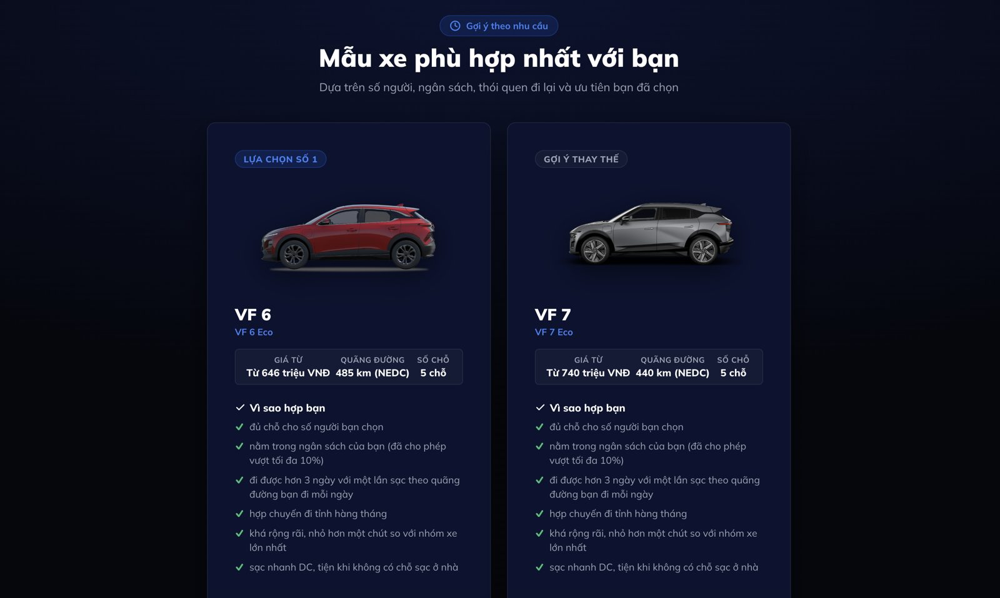
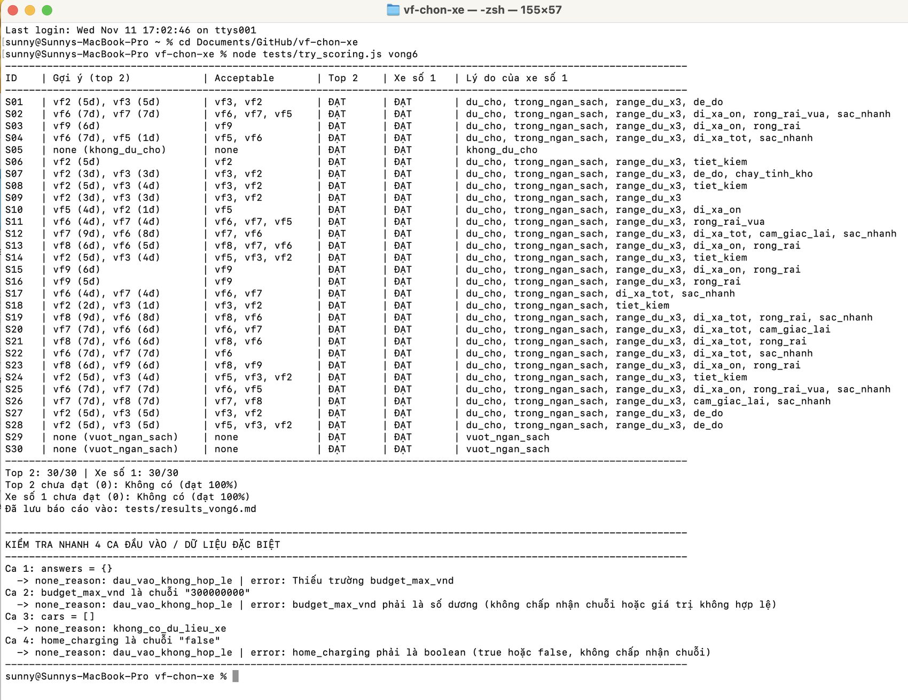

# VF Chọn Xe

**Trợ lý giúp người mua xe điện lần đầu chọn mẫu VinFast theo nhu cầu thật. Code chọn xe, AI chỉ giải thích, và độ chính xác được đo bằng bộ kiểm thử.**

- Demo: `[DÁN LINK VERCEL]`
- Video 60–90 giây: `[DÁN LINK VIDEO]`
- Tác giả: Phạm Hồng Mai (Nhật Mai) · Dự án cá nhân cho hồ sơ chương trình AI Thực Chiến, làm trong 2 tuần (6–19/11/2026)

> Dự án cá nhân, phi thương mại, không phải trang chính thức của VinFast. Thông số tra trên vinfastauto.com ngày 8/11/2026, vui lòng kiểm tra lại trước khi mua.



---

## 1. Vấn đề

Người mua xe điện lần đầu thường hỏi ba câu: xe nào vừa với nhà mình, đi được bao xa, mỗi tháng tốn bao nhiêu. Chatbot AI trả lời rất trôi chảy, nhưng với thông số xe thì trôi chảy chưa đủ: một con số bịa về giá hay quãng đường có thể dẫn tới quyết định sai vài trăm triệu đồng.

Tôi không biết lập trình (nền tảng của tôi là thiết kế đồ hoạ và video AI). Câu hỏi tôi đặt ra cho dự án là: **làm sao dùng AI để xây một sản phẩm mà chính tôi kiểm chứng được nó đúng?**

## 2. Giải pháp

Người dùng trả lời 6 câu hỏi (số người, ngân sách, quãng đường mỗi ngày, tần suất đi tỉnh, có chỗ sạc ở nhà không, ưu tiên gì). Ứng dụng trả về:

1. **Hai mẫu xe hợp nhất** trong 7 mẫu (VF 2, VF 3, VF 5, VF 6, VF 7, VF 8, VF 9), kèm lý do từng xe.
2. **Chi phí vận hành ước tính mỗi tháng** so với một xe xăng tham chiếu, có công tắc "Tôi được sạc miễn phí".
3. **Bảng so sánh hai xe** và **lời giải thích bằng tiếng Việt do AI viết** từ đúng dữ liệu của hai xe đó.
4. Khi không có xe nào phù hợp, ứng dụng nói thẳng và nêu lý do, không cố gợi ý.

Màn mở đầu xếp 7 xe theo đúng tỉ lệ chiều dài thật để người dùng thấy ngay xe nào to, xe nào nhỏ.

## 3. Vì sao dùng AI theo cách này

**Nguyên tắc: code quyết định chọn xe, AI chỉ giải thích.**

| Việc | Ai làm | Vì sao |
|---|---|---|
| Loại xe, chấm điểm, xếp hạng | Quy tắc viết bằng code (`scoring.js`) | Minh bạch, chạy lại ra cùng kết quả, kiểm thử được bằng 30 tình huống |
| Tính chi phí điện và xăng | Công thức (`cost.js`) | Phép tính phải đúng, đối chiếu được bằng tay |
| Viết lời giải thích tiếng Việt | Gemini Flash (`api/ask.js`) | Việc AI làm tốt: diễn đạt tự nhiên từ dữ liệu có sẵn |

Các hàng rào quanh AI:

- AI chỉ nhận dữ liệu của hai xe đầu bảng và kết quả chấm điểm. Prompt cấm nêu con số không có trong dữ liệu; ô trống thì nói "chưa có dữ liệu".
- VF 9 đo quãng đường theo chuẩn WLTP, sáu xe còn lại theo NEDC. Ứng dụng luôn ghi kèm chuẩn đo và không so trực tiếp hai xe khác chuẩn.
- Câu trả lời của người dùng bị kiểm tra bằng code trước khi tới AI (đúng kiểu, đúng danh sách giá trị). Đầu vào xấu bị từ chối ngay, không tốn lượt gọi AI và không có chỗ để chèn lệnh.
- Khi AI lỗi (hết lượt, quá tải, quá thời gian), trang vẫn hiện lời giải thích dựng tự động từ dữ liệu và ghi rõ đó là bản tự động. Người dùng không bao giờ thấy trang trống.
- API key chỉ nằm trong biến môi trường của Vercel, không có trong code hay trình duyệt.

## 4. Kết quả đo được

Tôi không tiếp cận được người dùng thật trong hai tuần, nên đo bằng bộ kiểm thử tự viết. Giới hạn của cách đo này được nêu ở mục 6.

### 4.1. Chọn xe: 30 tình huống người mua

30 tình huống chia 8 nhóm (sinh viên, gia đình trẻ, gia đình đông người, chạy dịch vụ, hay đi tỉnh, ở chung cư không có chỗ sạc, người lớn tuổi, và 3 tình huống bẫy mà đáp án đúng là "không có xe phù hợp"). Mỗi vòng chỉ đổi **một loại** (code, luật, hoặc đáp án) rồi chạy lại.

| Vòng | Đổi gì | Loại | Top 2 | Xe số 1 |
|---|---|---|---|---|
| 0–1 | Thêm thước đo chặt hơn: xe xếp hạng 1 phải nằm trong đáp án | Thước đo | 28/30 | 25/30 |
| 2 | Kiểm tra kiểu dữ liệu đầu vào, gắn lý do đúng chỗ | Code | 28/30 | 25/30 |
| 3 | "Rộng rãi" chấm theo bậc chiều dài | Luật | 29/30 | 26/30 |
| 4 | Trừ điểm xe phải sạc mỗi ngày và xe chạy tỉnh khó | Luật | 30/30 | 26/30 |
| 5 | Tình huống S04: thêm VF 6 vào đáp án | Đáp án | 30/30 | 27/30 |
| 6 | Tình huống S14, S24, S28: thêm VF 2 vào đáp án | Đáp án | 30/30 | 30/30 |

Hai điều cần nói thật về bảng này:

- **28/30 ban đầu là điểm dễ.** Khi một AI khác (Claude Code) soát lại, nó chỉ ra rằng nếu chỉ tính xe xếp hạng 1 thì chỉ đạt 25/30. Tôi thêm thước đo chặt hơn và báo cả hai con số.
- **Bốn điểm cuối đến từ việc sửa đáp án, không phải sửa luật.** Ví dụ ở S14, S24, S28 (gia đình 3 người, đi 15 km mỗi ngày, hiếm khi đi tỉnh), đáp án cũ chấp nhận VF 3 nhưng không chấp nhận VF 2, dù hai xe cùng 4 chỗ và VF 2 rẻ hơn 97 triệu đồng. Muốn ép VF 5 lên đầu thì phải thêm luật "xe chật", mà dữ liệu không có dung tích cốp, nên tôi không thêm.



### 4.2. Hỏi đáp thông số: 25 câu hỏi

25 câu gồm 18 câu thường và 7 câu bẫy (hỏi phiên bản không tồn tại, khuyến mãi, mẫu xe không có trong dữ liệu, giá lăn bánh, bảo hiểm, độ chai pin, so với hãng khác). Hai câu hỏi đúng vào ô dữ liệu trống để xem AI có nói "chưa có dữ liệu" không. Tôi tách hai loại lỗi:

- **Bịa thông số** (nghiêm trọng): nêu con số không có trong dữ liệu. Mục tiêu: 0.
- **Thêm diễn giải ngoài dữ liệu** (nhẹ): không sai số, nhưng nói thêm điều dữ liệu không ghi.

| Chỉ số | Kết quả |
|---|---|
| Số câu đã đo | 25/25 |
| Đạt hoàn toàn | 23 |
| Bịa thông số | 0 |
| Thêm diễn giải ngoài dữ liệu | 2 (Q13, Q18) |
| So trực tiếp NEDC với WLTP | 0 (Q04 nêu cả hai số kèm chuẩn và nói không so trực tiếp được) |

Máy chấm gắn nhãn "cần xem" cho 3 câu mà tôi duyệt tay là đạt: Q04 (nói trên), Q20 và Q21 (hỏi đúng ô dữ liệu trống; AI nói đúng là không có thông tin, nhưng dùng chữ khác cụm "chưa có dữ liệu" mà máy tìm; riêng Q20 còn để lộ chữ `null` trong câu trả lời, một lỗi trình bày nhỏ). Q18 (VF 3 chạy 70 km mỗi ngày) tự tính 215 ÷ 70 ≈ 3,07 ngày rồi kết luận "khoảng 3 ngày": phép tính đúng nhưng con số 3,07 không có sẵn trong dữ liệu, và AI thêm lời nhắc về thời tiết, thói quen lái; tôi xếp vào "thêm diễn giải".

Ví dụ về "thêm diễn giải": dữ liệu ghi bảo hành VF 8 là "10 năm / 200.000 km", AI viết thành "10 năm hoặc 200.000 km (tùy điều kiện nào đến trước)". Câu thêm vào nghe hợp lý nhưng dữ liệu không nói vậy.

Điều kiện đo: bản prompt hỏi đáp ban đầu, một model (`gemini-3.6-flash`), tắt model dự phòng, chạy thành nhiều đợt trong 3 ngày vì gói miễn phí giới hạn khoảng 20 lượt gọi mỗi ngày. Máy chấm tự động chỉ sàng lọc (tìm số lạ, từ khoá thiếu, dấu hiệu so khác chuẩn); các câu bị gắn "cần xem" do người duyệt và đối chiếu với `data/cars.json`. Toàn bộ câu trả lời nằm trong [`tests/results_eval.md`](tests/results_eval.md).

### 4.3. Các phép kiểm khác

| Bài kiểm | Kết quả | Kiểm cái gì |
|---|---|---|
| `tests/try_cost.js` | 4/4 | Chi phí điện, xăng (đã tự tính tay đối chiếu), và trường hợp thiếu dữ liệu |
| `tests/try_ask.js` | 7/7 | Giả lập AI lỗi (hết lượt, quá tải, quá thời gian, bị chặn): trang vẫn có lời giải thích; đầu ra không chứa chuỗi giống key |
| Đầu vào đặc biệt | 4/4 | Đáp án rỗng, số ở dạng chữ, danh sách xe rỗng: báo lỗi rõ thay vì chạy sai trong im lặng |

## 5. Quy trình và công cụ

**Cách chia việc**

| Công cụ | Vai trò |
|---|---|
| Antigravity (Gemini Flash) | Viết phần lớn code theo hướng dẫn từng ngày |
| Claude Code | Soát chéo code quan trọng, chỉ đọc và chỉ ra lỗi; tôi quyết định sửa gì |
| Claude (chat) | Lập kế hoạch, viết hướng dẫn từng bước, nhật ký, soát bảo mật |
| Gemini Flash qua API | Chạy trong ứng dụng để viết lời giải thích |
| Tôi | Tra và nhập dữ liệu 7 xe, viết 30 tình huống và 25 câu hỏi, thiết kế giao diện, xử lý ảnh xe, chạy thử, quyết định |

Hai AI khác hãng kiểm tra nhau là có chủ ý: chính lần soát chéo đã phát hiện điểm 28/30 dễ hơn thực tế.

**Ba thói quen giữ xuyên suốt**

1. Mỗi vòng chỉ đổi một thứ, chạy lại bài kiểm, ghi "đổi gì, từ X lên Y".
2. Không tin vì câu văn trôi chảy: số AI nêu phải đối chiếu với bảng thông số.
3. Mỗi ngày commit một lần kèm ảnh chụp lỗi và cách sửa (thư mục [`docs/screens/`](docs/screens/)).

**Một số lỗi đã gặp và điều học được**

| Lỗi | Nguyên nhân | Bài học |
|---|---|---|
| Xe ở màn mở đầu sai tỉ lệ, lệch hàng, sửa chỗ này hỏng chỗ kia | Vá bằng prompt nhiều lần trên CSS cũ | Viết lại thành một mô-đun riêng, có bảng số để tự kiểm tỉ lệ |
| Trang không hiện xe khi mở file trực tiếp | Trình duyệt chặn đọc dữ liệu từ `file://` | Không phải lúc nào làm theo AI cũng đúng, cần hiểu vì sao |
| Trên iPhone SE cả trang bị thu nhỏ | Một dòng chữ tràn ngang | Sửa xong một lỗi phải kiểm lại cả máy tính lẫn điện thoại |
| AI báo "key không hợp lệ" | Key bị lưu kèm dấu `<` `>` | Tách lỗi bằng lệnh nhỏ trước khi nghi code |
| Hết lượt gọi AI giữa lúc đo | Gói miễn phí khoảng 20 lượt/ngày | Hạn mức là ràng buộc thiết kế: chia đợt đo và làm sẵn phương án khi AI lỗi |
| File kết quả đo bị trộn | Chạy hai lệnh đo cùng lúc | Một lệnh một lúc |
| Trang hỏng suốt một buổi sáng | Đổi tên file dữ liệu để giả lập lỗi rồi quên đổi lại | Giả lập lỗi xong phải dọn ngay |

## 6. Giới hạn và bước tiếp theo

**Giới hạn đã biết**

- Luật chấm điểm và bộ đáp án do cùng một người viết. 30/30 chứng minh luật nhất quán với đáp án (đã chỉnh 4 đáp án), chưa chứng minh gợi ý đúng với người mua ngoài đời.
- Bộ 25 câu hỏi nhỏ, chạy một model, máy chấm theo từ khoá cần người duyệt lại. Câu trả lời của AI đổi cách diễn đạt giữa các lần chạy.
- Mới có 7 mẫu, mỗi mẫu một phiên bản. Chưa có VF MPV 7, VF 8 thế hệ mới, VF Wild. Dữ liệu nhập tay ngày 8/11/2026, có 5 ô để trống vì trang hãng không ghi.
- Chi phí là ước tính: mức tiêu thụ điện suy từ dung lượng pin chia quãng đường công bố, chưa tính hao hụt khi sạc; xe xăng tham chiếu 7,5 lít/100 km là giả định minh hoạ; giá điện, giá xăng là số cố định có ghi ngày, người dùng chưa tự nhập được.
- Chính sách miễn phí sạc chỉ có nguồn báo chí nên công tắc mặc định tắt.
- Gói AI miễn phí: khoảng 20 lượt mỗi ngày, đôi lúc quá tải. Ai cũng gọi được `/api/ask`; bộ giới hạn 10 lượt/phút nằm trong bộ nhớ của hàm nên không chắc chắn trên môi trường serverless. Khi hết lượt, người dùng thấy bản giải thích tự động.
- Chưa có ô hỏi đáp trên giao diện; chế độ hỏi đáp mới dùng trong bộ đo.

**Nếu có thêm thời gian**

1. Thử với 5–10 người đang định mua xe, so gợi ý của ứng dụng với lựa chọn của họ.
2. Nhờ người khác viết bộ đáp án độc lập.
3. Tự động cập nhật dữ liệu và thêm các mẫu còn thiếu, nhiều phiên bản mỗi mẫu.
4. Kiểm tra tự động mọi con số trong câu trả lời của AI ngay trên máy chủ trước khi hiện ra.
5. Ô hỏi đáp và bản đồ trạm sạc.

## 7. Chạy thử

```
git clone https://github.com/nhatmaiverse/vf-chon-xe.git
cd vf-chon-xe
python3 -m http.server 8000      # mở http://localhost:8000
node tests/try_scoring.js        # 30 tình huống, không cần AI
node tests/try_cost.js           # máy tính chi phí
node tests/try_ask.js            # giả lập AI lỗi, không gọi mạng
node tests/run_eval.js           # liệt kê 25 câu hỏi, không gọi mạng
```

Ở máy cục bộ phần lời giải thích AI không chạy (cần hàm `/api/ask` trên Vercel và biến môi trường `GEMINI_API_KEY`, `GEMINI_MODEL`). Các phần còn lại chạy đầy đủ.

**Cấu trúc chính:** `scoring.js` (luật chọn xe) · `cost.js` (chi phí) · `api/ask.js` (gọi AI, có hạ cấp khi lỗi) · `data/` (thông số và giá, có nguồn và ngày) · `tests/` (bộ kiểm thử và kết quả từng vòng) · `PLAN.md` (bản thiết kế giao cho AI lập trình) · `docs/screens/` (ảnh chụp quá trình).
